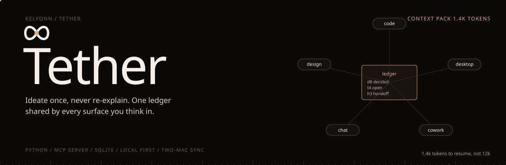
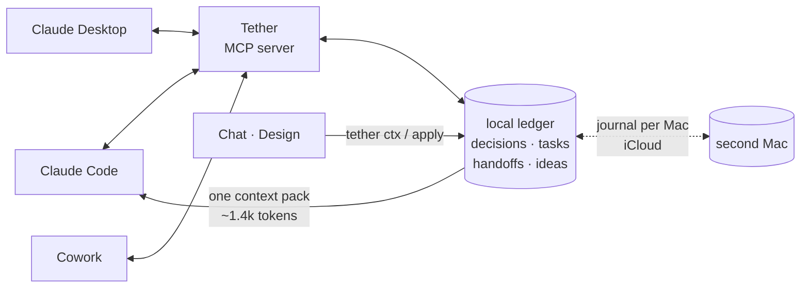

<p align="center">
  
</p>

<p align="center">
  <b>Ideate once. Never re-explain.</b><br>
  <sub>A local project ledger shared by Claude Code, Claude Desktop, Cowork, Chat and Design. It records what was decided, what is done, what is next, and who has the ball, so every new session starts already knowing.</sub>
</p>

<p align="center">
  <sub>
    <a href="#overview">OVERVIEW</a> &nbsp;·&nbsp;
    <a href="#quick-start">QUICK START</a> &nbsp;·&nbsp;
    <a href="#the-context-pack">THE CONTEXT PACK</a> &nbsp;·&nbsp;
    <a href="#install">INSTALL</a> &nbsp;·&nbsp;
    <a href="#use">USE</a> &nbsp;·&nbsp;
    <a href="#surfaces-without-mcp">SURFACES WITHOUT MCP</a> &nbsp;·&nbsp;
    <a href="#two-macs">TWO MACS</a>
  </sub>
</p>

<br>

<table>
  <tr>
    <td><sub>TO RESUME A PROJECT</sub><br><b>~1.4k tokens, not ~12k</b></td>
    <td><sub>STORAGE</sub><br><b>Local, on your machine</b></td>
    <td><sub>INTERFACE</sub><br><b>MCP server + CLI</b></td>
    <td><sub>SECRETS</sub><br><b>Refused on every write</b></td>
    <td><sub>TESTS</sub><br><b>81</b></td>
  </tr>
</table>

## Overview

Every new AI session starts from zero, and you end up re-explaining the project each time. Tether fixes that with a small local ledger that every surface reads and writes: what was decided, what is done, what is next, and who has the ball.

> [!TIP]
> Run `tether doctor --deep` after installing. It starts the real server against a temporary store and drives it end to end, without touching your data.

## Quick start

```bash
uv tool install -e .
tether install                                     # registers the MCP server and hook
tether init --goal "Sell mugs online by December"  # in your project folder
```

## How it works




## The context pack

Every session opens with one compact pack: the goal, the status, what was handed to you, what changed since you were last here, open tasks, and active decisions. On a synthetic three-month project it is about 1.4k tokens, against about 12k for the full history. Closed tasks and superseded decisions are never re-read; they stay searchable.

```
# Shop · tether [shop]
Goal: Sell mugs online by December
Status: Product page designed; cart next (2h ago)
You are: code.

## Handed to you (1)
- h3 from design (2h ago): Product page mockup
  Hero, gallery, reviews. Final copy in link.        tasks: t4

## Since code was last here
- 2h ago design: decided: Serif headings, mono prices
- 3h ago chat: added task: Annual pricing toggle

## Open tasks (5 open, 12 closed and hidden)
- t4 P1 Build product page
- t7 [blocked] Stripe webhook — waiting on account approval
- t9 (design) Empty cart state

## Decisions (6 active, newest first)
- d8 Shopify Storefront API, not custom backend — why: ship in weeks
```

## Install

```bash
uv tool install -e .        # from this folder
tether install              # registers the MCP server and hook
tether doctor --deep        # an end-to-end self-test in a temporary store; every line should say ok
```

`tether install` merges only its own keys into your config files and backs each one up first. `--dry-run` previews the change, `--uninstall` removes it. `doctor --deep` never touches your real data.

## Use

```bash
cd ~/code/shop
tether init --goal "Sell mugs online by December"     # binds this folder to a project
```

From there the bookkeeping happens as you work. The server ships its own rules: record decisions as they are settled, add and close tasks tagged with the surface that should do them, hand work across surfaces, and update the status at milestones. Nothing ever guesses which project it is in.

<details>
<summary><b>The CLI</b></summary>
<br>

| | |
|---|---|
| `tether ls` | projects |
| `tether ctx [--for code\|chat\|design]` | the context pack |
| `tether tasks` · `tether add "title" --for code -P 1` | tasks |
| `tether start\|done\|block\|drop t12` | task status |
| `tether decide "text" --why "…" [--replaces d3]` | a decision |
| `tether handoff design "title" --body "…" --task t4` | hand work across |
| `tether inbox` · `accept h3` · `deliver h3` | handoffs and unfiled ideas |
| `tether search stripe` · `show d3` · `log` | history |
| `tether remember` · `recall` · `attach` · `promote` | ideas, with or without a project |
| `tether git install` | "fixes t12" in a commit closes the task |
| `tether ui` | an editable live view on localhost |

</details>

## Surfaces without MCP

For Chat and Design, copy the pack in and the update out:

```bash
tether ctx --for chat --copy      # paste it into the conversation
tether apply --paste              # the conversation ends with an update block; apply it
```

`tether mirror --dir <folder>` writes every project as markdown into a folder those surfaces can read, such as Google Drive.

## Two Macs

```bash
tether sync setup        # on each Mac; iCloud Drive by default
```

Each Mac keeps its own database and appends only to its own journal in the shared folder. Nothing writes the same file from two machines, so iCloud never sees a conflict. Changes merge field by field, newest edit wins per field, so finishing a task on one Mac and renaming it on the other both survive.

<sub>MIT.</sub>
